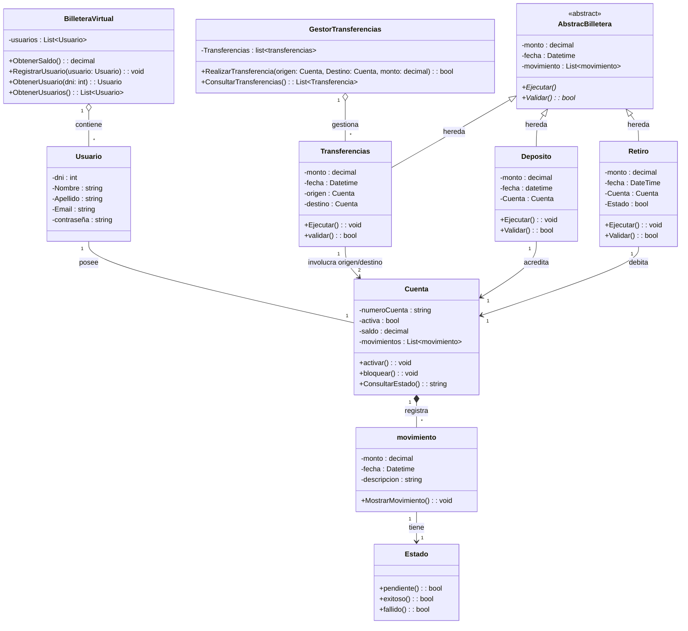

# Modelo de Dominio - Billetera Virtual

---

## Justificación del Modelo

### 1. Agregación vs. Composición
* **Composición (`Cuenta *-- movimiento`):** Los movimientos son parte fundamental del historial de una cuenta. Si la cuenta desaparece, sus movimientos pierden sentido y existencia en el sistema.
* **Agregación (`BilleteraVirtual o-- Usuario`):** Los usuarios existen por sí mismos dentro del dominio del sistema independientemente de la instancia del gestor o la billetera.
* **Agregación (`GestorTransferencias o-- Transferencias`):** El gestor administra la lista de transferencias, pero no destruye el registro histórico si el gestor deja de existir.

### 2. Justificación de la Jerarquía
La abstracción `AbstracBilletera` define la interfaz de ejecución de operaciones transaccionales (`Ejecutar()` y `Validar()`). Cada subclase cambia su **comportamiento dinámico**:
* **`Transferencias`**: Valida saldo en la cuenta origen y acredita en una cuenta destino distinta de forma atómica.
* **`Deposito`**: Valida credenciales e interactúa con medios de ingreso externos (tarjeta/banco) para incrementar el saldo de una sola cuenta.
* **`Retiro`**: Valida saldo disponible y límites de extracción para egresar dinero a un canal externo.
