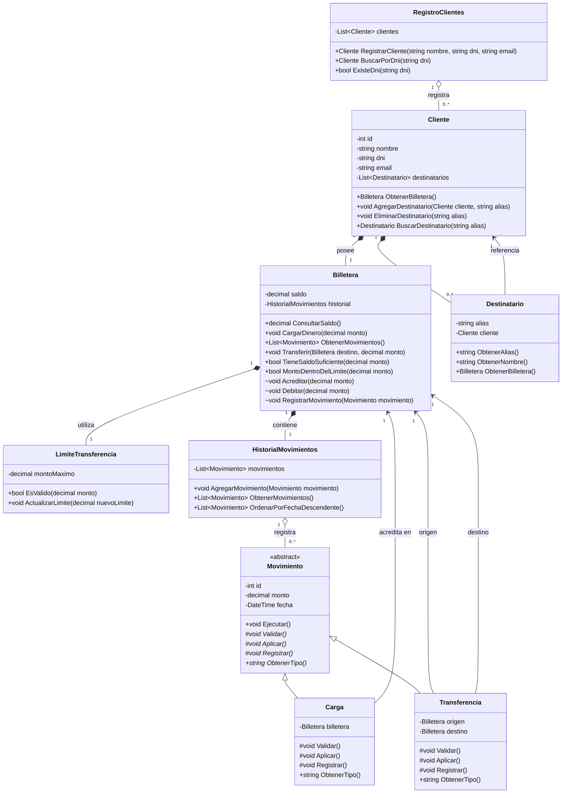
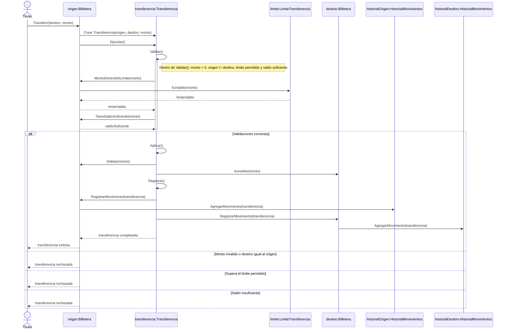

# Modelo de Dominio - Billetera Virtual

## Diagrama de clases



## Justificación del modelo

### Responsabilidades principales

- **RegistroClientes** administra los clientes registrados y evita DNIs duplicados.
- **Cliente** representa a la persona registrada, posee una billetera y administra sus destinatarios.
- **Billetera** administra el saldo y coordina cargas, transferencias e historial.
- **LimiteTransferencia** encapsula la regla de negocio del monto máximo permitido.
- **HistorialMovimientos** registra y consulta las operaciones de una billetera.
- **Movimiento** define el flujo común de las operaciones mediante Template Method.
- **Carga** y **Transferencia** implementan comportamientos distintos de validación, aplicación y registro.
- **Destinatario** representa una referencia guardada a otro cliente registrado.

### Agregación y composición

- **Cliente *-- Billetera:** la billetera pertenece al cliente y se crea junto con su registro.
- **Cliente *-- Destinatario:** los destinatarios guardados pertenecen al cliente que los administra.
- **Billetera *-- HistorialMovimientos:** cada billetera contiene su propio historial.
- **Billetera *-- LimiteTransferencia:** la billetera utiliza su propia regla de límite.
- **HistorialMovimientos o-- Movimiento:** se usa agregación porque una misma transferencia puede quedar referenciada en los historiales de origen y destino.
- **RegistroClientes o-- Cliente:** el registro administra una colección de clientes, pero el cliente es una entidad del dominio con identidad propia.

### Template Method

La clase abstracta `Movimiento` define el flujo general:

```text
Ejecutar()
  → Validar()
  → Aplicar()
  → Registrar()
```

`Carga` y `Transferencia` redefinen esos pasos porque su comportamiento es diferente.

## Diagrama de secuencia - Realizar transferencia



## Decisiones de diseño del flujo

- El diagrama comienza cuando la billetera destino ya fue seleccionada.
- La validación se concentra en `Transferencia.Validar()`.
- Antes de modificar los saldos se verifica el monto, que origen y destino sean distintos, el límite permitido y el saldo disponible.
- `Transferencia.Aplicar()` realiza el débito en origen y la acreditación en destino.
- `Transferencia.Registrar()` registra la misma transferencia en ambos historiales a través de las billeteras.
- El acceso al historial queda encapsulado mediante `Billetera.RegistrarMovimiento()`.
