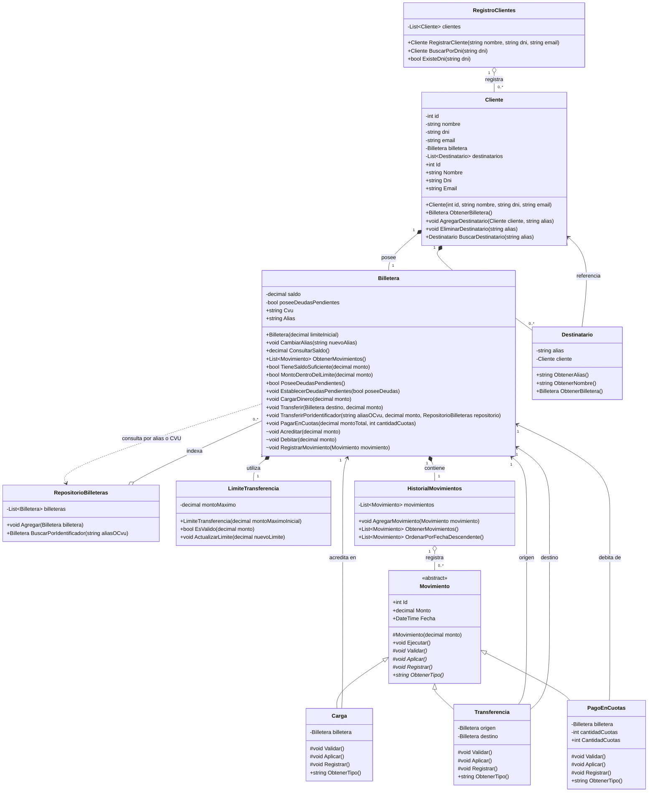
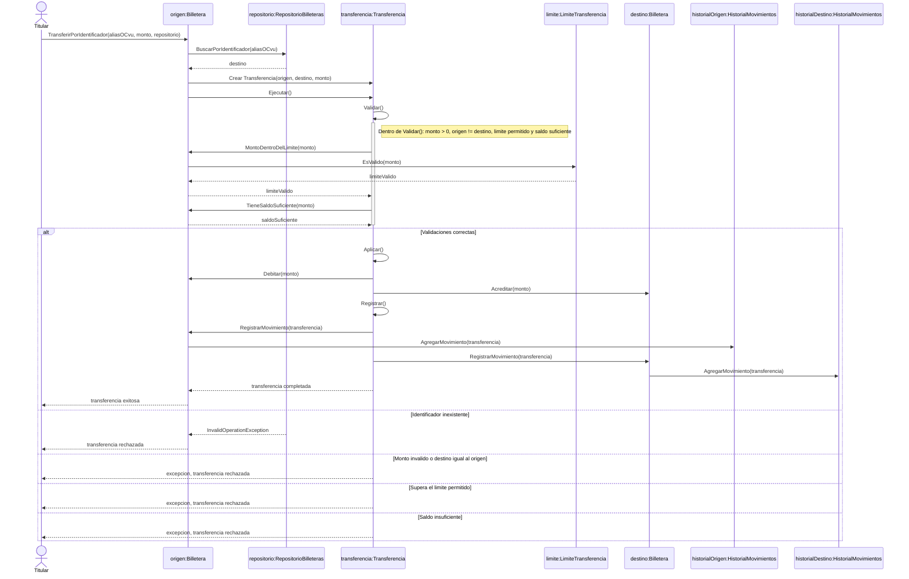
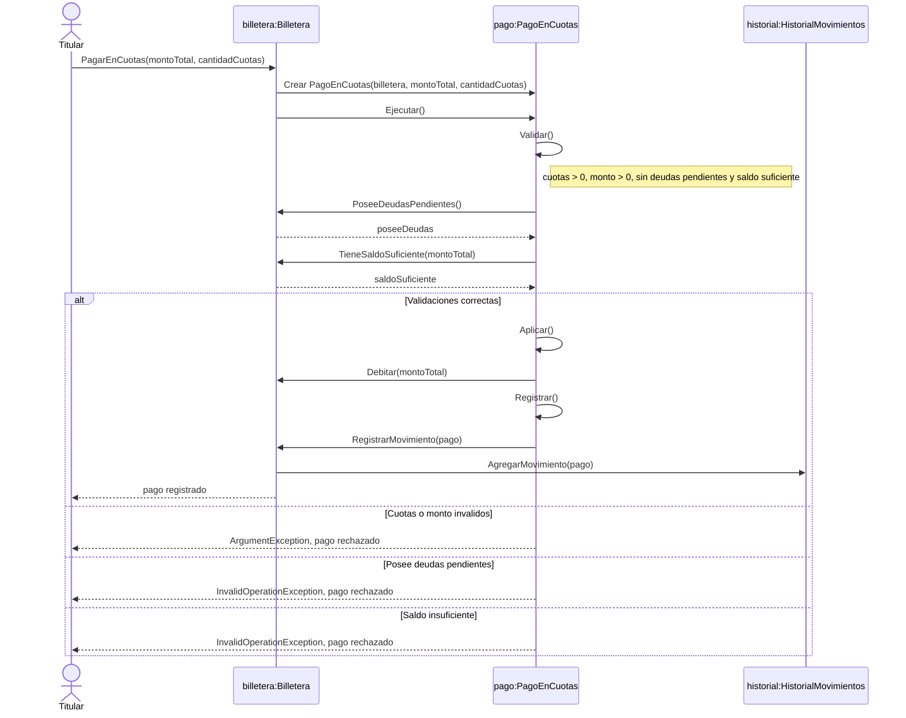

# Modelo de Dominio - Billetera Virtual

## Diagrama de clases



## Justificación del modelo

### Responsabilidades principales

- **RegistroClientes** administra los clientes registrados, asigna su id y evita DNIs duplicados.
- **Cliente** representa a la persona registrada (valida nombre, DNI y formato de email), posee una billetera y administra sus destinatarios.
- **Billetera** administra el saldo, identifica a la cuenta con un **CVU** y un **alias** modificable, y coordina cargas, transferencias, pagos en cuotas e historial. Las operaciones públicas delegan en objetos `Movimiento`.
- **RepositorioBilleteras** permite ubicar una billetera destino a partir de su alias o su CVU, sin necesidad de conocer al cliente.
- **LimiteTransferencia** encapsula la regla de negocio del monto máximo permitido (por defecto 500.000).
- **HistorialMovimientos** registra y consulta las operaciones de una billetera; devuelve copias de la lista para proteger su estado interno.
- **Movimiento** define el flujo común de las operaciones mediante Template Method.
- **Carga**, **Transferencia** y **PagoEnCuotas** implementan comportamientos distintos de validación, aplicación y registro.
- **Destinatario** representa una referencia guardada a otro cliente registrado.

### Agregación y composición

- **Cliente *-- Billetera:** la billetera pertenece al cliente y se crea junto con su registro.
- **Cliente *-- Destinatario:** los destinatarios guardados pertenecen al cliente que los administra.
- **Billetera *-- HistorialMovimientos:** cada billetera contiene su propio historial.
- **Billetera *-- LimiteTransferencia:** la billetera utiliza su propia regla de límite.
- **HistorialMovimientos o-- Movimiento:** se usa agregación porque una misma transferencia puede quedar referenciada en los historiales de origen y destino.
- **RegistroClientes o-- Cliente:** el registro administra una colección de clientes, pero el cliente es una entidad del dominio con identidad propia.
- **RepositorioBilleteras o-- Billetera:** el repositorio solo indexa billeteras; no controla su ciclo de vida, por eso es agregación.
- **Billetera ..> RepositorioBilleteras:** dependencia de uso; el repositorio llega como parámetro de `TransferirPorIdentificador` y la billetera no lo almacena.

### Visibilidad de los métodos de Billetera

`Acreditar`, `Debitar` y `RegistrarMovimiento` son `internal` (`~` en el diagrama): solo los movimientos del dominio pueden modificar el saldo o el historial. Desde afuera, la única forma de alterar una billetera es a través de `CargarDinero`, `Transferir`, `TransferirPorIdentificador` y `PagarEnCuotas`.

### Template Method

La clase abstracta `Movimiento` define el flujo general en `Ejecutar()`, que no es redefinible:

```text
Ejecutar()
  → Validar()
  → Aplicar()
  → Registrar()
```

`Carga`, `Transferencia` y `PagoEnCuotas` redefinen esos pasos porque su comportamiento es diferente:

| Movimiento | Validar | Aplicar | Registrar |
|---|---|---|---|
| **Carga** | monto > 0 | acredita en la billetera | historial de la billetera |
| **Transferencia** | monto > 0, origen ≠ destino, límite permitido, saldo suficiente | debita en origen y acredita en destino | historial de origen y de destino |
| **PagoEnCuotas** | cuotas > 0, monto > 0, sin deudas pendientes, saldo suficiente | debita el monto total | historial de la billetera |

## Diagrama de secuencia - Realizar transferencia



## Diagrama de secuencia - Pagar en cuotas



## Decisiones de diseño del flujo

- El diagrama de transferencia comienza con la búsqueda de la billetera destino por alias o CVU. `Transferir(destino, monto)` es el mismo flujo, pero con el destino ya resuelto.
- La validación se concentra en `Transferencia.Validar()`.
- Antes de modificar los saldos se verifica el monto, que origen y destino sean distintos, el límite permitido y el saldo disponible.
- `Transferencia.Aplicar()` realiza el débito en origen y la acreditación en destino.
- `Transferencia.Registrar()` registra la misma transferencia en ambos historiales a través de las billeteras.
- El acceso al historial queda encapsulado mediante `Billetera.RegistrarMovimiento()`.
- Las validaciones fallidas se informan con excepciones (`ArgumentException` para datos inválidos e `InvalidOperationException` para reglas de negocio); como `Validar()` corre antes de `Aplicar()`, un rechazo nunca deja saldos ni historiales modificados.
- `PagoEnCuotas` sigue el mismo flujo del Template Method: se debita el monto total en una sola operación y se guarda la cantidad de cuotas en el movimiento.


    
